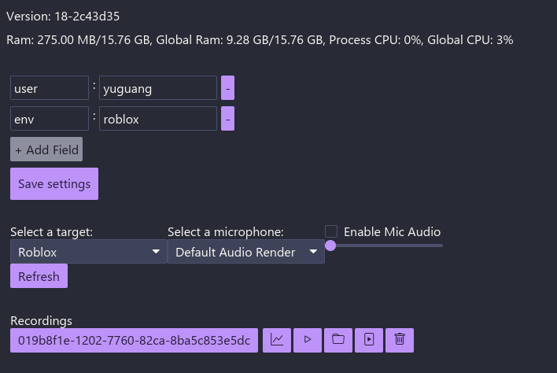

# Recap

Recap is a tool for:
1. **Recording videos**: record screen along with keyboard and mouse input
2. **Connect model inference server to interact with game environment**: a running inference server with screen capture and bidirectional communication

---

## Setup (Windows)

### Prerequisites

#### Install Git
```bash
winget install --id Git.Git -e --source winget
```

Add Git Unix tools to your Windows system PATH to enable Linux-style commands in Command Prompt or PowerShell:

1. Press the Windows key, type "environment variables", and select **Edit the system environment variables**
2. In the **System variables** section, find and select `Path`, then click **Edit...**
3. Click **New** and paste (if installed with default settings): `C:\Program Files\Git\usr\bin`
4. Click **OK** on all open windows

Then clone the repo:
```bash
git clone https://github.com/elefant-ai/recap.git
```

#### Install Rust

Download and run the installer from:
```
https://static.rust-lang.org/rustup/dist/x86_64-pc-windows-msvc/rustup-init.exe
```

#### Install Just
```bash
cargo install just
```

> **Note:** If you encounter "linker `link.exe` not found", download the [Visual Studio Build Tools](https://visualstudio.microsoft.com/visual-cpp-build-tools/), choose the custom installation option, and check the box for **Desktop development with C++**.

#### Install GStreamer

Download and install **both** the runtime and development versions:

- [gstreamer-1.0-msvc-x86_64-1.26.0.msi](https://gstreamer.freedesktop.org/data/pkg/windows/1.26.0/msvc/gstreamer-1.0-msvc-x86_64-1.26.0.msi)
- [gstreamer-1.0-devel-msvc-x86_64-1.26.0.msi](https://gstreamer.freedesktop.org/data/pkg/windows/1.26.0/msvc/gstreamer-1.0-devel-msvc-x86_64-1.26.0.msi)

> **Important:** During installation, select **Complete** to install all features.

Add the GStreamer bin directory to your PATH (default: `C:\Program Files\gstreamer\1.0\msvc_x86_64\bin`).

#### Install Protobuf
```bash
winget install Google.Protobuf
```

---

## User Interface



The interface is organized into several sections:

- **Header:** Displays software version and resource usage
- **Settings:** Fields to add metadata. Feel free to remove them (click on `-` icon) if you don't need it.
- **Window Selection:** Choose the window you want to capture (the microphone option is deprecated)
- **Recordings:** Appears after you make recordings. Click the folder icon to view recorded videos and check the `annotation.proto` file containing keyboard and mouse actions

---

## Getting Started

Run the following command to launch Recap:
```bash
just trace
```

> **Tip:** Set `GST_DEBUG_DUMP_DOT_DIR="some_path"` to dump a dot file of the pipeline for debugging.

---

## Usage

### Recording Only

1. Select the window you want to capture
2. Press `]` to start/stop recording

> Note: if you see error such as *Error starting capture: Mouse acceleration is somehow enabled*, try to disable the mouse acceleration from windows settings and restart the app.
### Recording with Inference (make sure the inference server is running at `/tmp/uds.recap`)

1. Press `Shift + ]` to start recording with inference (streams frames to an inference server for real-time model control)
2. Model control pauses when you press any key or move the mouse
3. Press `[` to resume model control
4. Press `Shift + ]` to stop recording with inference

### Audio Feedback

| Sound | Meaning |
|-------|---------|
| One beep | Recording started |
| Two beeps | Recording stopped |
| Long beep | Recording saved |

---

## Run Inference Server
Please refer to the [Open P2P repo](https://github.com/elefant-ai/open-p2p)

<!-- ## Inference

When recording with inference (`Shift + ]`), Recap connects to an inference server via WSL at `/tmp/uds.recap` and streams video frames in real-time.

> **Requirement:** `socat` must be installed in WSL (`sudo apt install socat`).

### Protocol

Recap uses Protocol Buffers for communication:

- **Frames sent to server:** RGB24 format with width, height, data, and frame ID
- **Actions received from server:** Keyboard keys, mouse movements (delta or absolute), scroll, and mouse buttons

--- -->